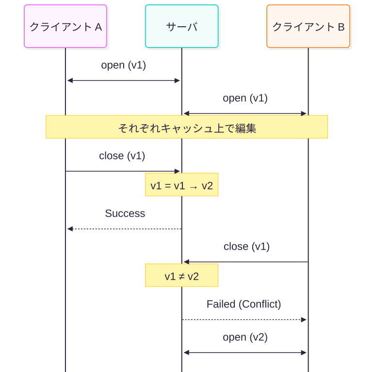
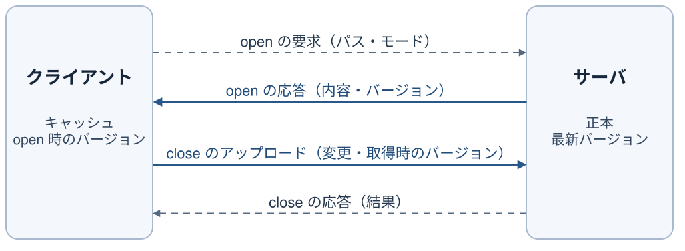

<!-- _class: lead -->
<!-- _paginate: false -->
<!-- _header: "" -->

# 分散ファイルシステム 設計
## 中間報告

東儀 隆弘
詹 栄盛

---

# ファイル共有: Session semantics

- `open` でファイルをキャッシュにコピー
- 編集はキャッシュ上で行う
- `close` まで変更をアップロードしない

---

# 変更許可: バージョン比較

- `open` で内容とバージョンを取得
- `close` で取得時のバージョンを送り返す
- サーバで比較し、不一致なら `Failed (Conflict)`

---

# 流れ

---

# データ管理

---

<!-- _class: api -->

# API

### `open(site, path, mode)` → file
- site: ファイルシステムの URI
- path: site 内のパス（なければ生成）
- mode: read only / write only / read-write

### `close(file, mode)`
- mode: アップロード / 破棄
- → Success / Not Found / Failed (Conflict)

### `read(file, offset, length, buf)`
### `write(file, offset, length, buf)`
- キャッシュ上のファイルを読み書き
- → Success / Not Found / Failed

---

<!-- _class: lead -->
<!-- _paginate: false -->

# ご清聴ありがとうございました
